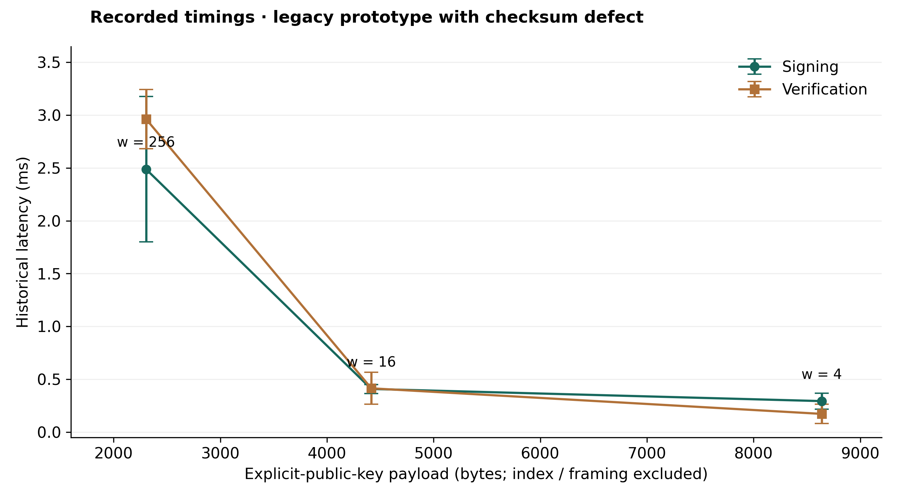
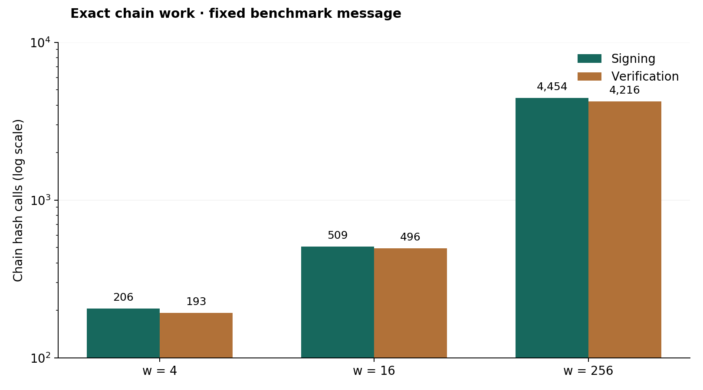
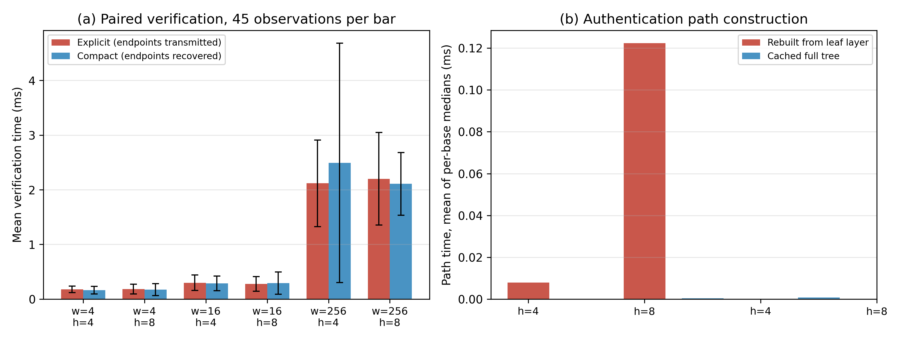
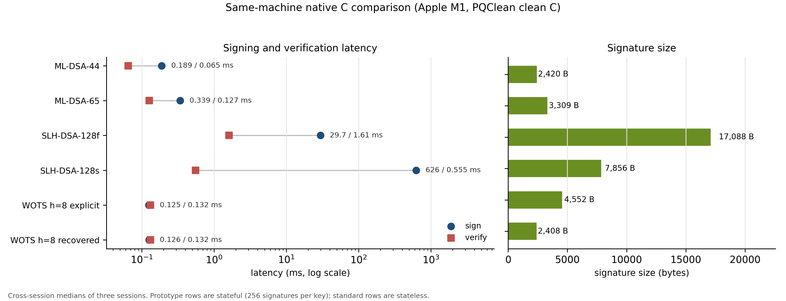

# Engineering Trade-offs in Merkle-Aggregated Winternitz Signatures

**Payload accounting, implementation reproducibility, and irreversible signing state under ledger reorganization**

**Abstract**

Merkle-aggregated Winternitz signatures offer a tunable communication–computation trade-off, but an implementation comparison must account for public-key transmission, complete verification, and signer state. We study a research artifact through a source audit, analytical accounting, and a separately implemented repaired variant. The audit identifies a checksum-encoding defect and a signature-size/verifier-input mismatch. For a 32-byte hash output at tree height four, explicit-key payloads span 8,640–2,304 bytes and endpoint recovery reduces them to 4,384–1,216 bytes; the smallest repaired configuration serializes to 1,224 bytes including its header. We measured complete verification over three bases, two heights, and 270 fresh-message samples, retaining environment metadata and raw observations; exact checksum-distribution calculations refine the usual chain-work approximation. We also distinguish irreversible signing exposure from reversible ledger confirmation, establish a conditional non-reuse invariant, and give a counterexample to exact recovery from confirmed-chain history alone. A bounded state exploration and negative-input tests make these findings reproducible. The repaired variant remains a fixed-prefix research construction, not standardized WOTS+, and no cryptographic security level is assigned. A like-for-like native C comparison on an identical construction, verified by matching Merkle roots, gives an operation-dependent Python-to-C gap of 1.7–1.9×. Stateful signing and verification are of the same order as ML-DSA-44 and faster to sign than SLH-DSA on this host within the stated measurement boundary (Table 11); these are implementation-level reference observations, not claims of equivalent security or overall superiority, and they come at the cost of key generation and a 256-signature capacity. File-based and SQLite durable-state backends pass crash, rollback, concurrency, tamper, and capacity tests. The results support precise engineering claims about payload accounting, verification boundaries, and recovery obligations rather than a new post-quantum signature primitive.

**Keywords:** hash-based signatures; Winternitz; Merkle trees; implementation audit; reproducibility; stateful signatures.

## 1. Introduction

The engineering appeal of hash-based signatures is that their central operations are hashes and byte-string manipulations. Their practical cost nevertheless depends on much more than the hash output length: Winternitz parameters determine chain work, Merkle authentication adds communication and storage, and one-time signing requires reliable state management. A comparison is meaningful only when the transmitted objects, verification inputs, and security assumptions are explicit.

We investigate four research questions: RQ1, how much communication is saved by recovering rather than transmitting the one-time public key; RQ2, how complete verification and authentication-path construction vary with the Winternitz base and tree height; RQ3, which claims survive an implementation-level correctness audit; and RQ4, whether confirmed-chain replay is sufficient to recover one-time signing state. We address these questions using source inspection, exact arithmetic, an independently coded experimental variant, and a signer-state model.

The contributions are: **C1**, an executable source-to-claim audit with corrected payload and checksum-work accounting; **C2**, two fully specified experimental wire formats and a paired verification study covering w ∈ {4, 16, 256} and h ∈ {4, 8}, with raw samples and negative-input tests; and **C3**, a conditional non-reuse invariant and a recovery counterexample separating key exposure from ledger acceptance. These are reproducibility and integration contributions. Endpoint recovery and state reservation are established techniques [1,2]; this work claims neither a new signature primitive nor priority for those techniques.

## 2. Background and Scope

### 2.1 Established schemes

XMSS specifies WOTS+ within a stateful Merkle construction and defines public-key recovery from a signature [1]. LMS provides another standardized stateful hash-based design [3]. NIST SP 800-208 discusses approved stateful schemes and their operational requirements [4]. These are appropriate reference points for a future implementation comparison.

SLH-DSA is the stateless hash-based signature standard in FIPS 205; ML-DSA is the module-lattice signature standard in FIPS 204 [5,6]. Their published sizes provide communication baselines. They do not establish a security level or performance baseline for this repository's custom construction.

### 2.2 Terminology and evidence

The source files use the label “WOTS+.” In this paper, **Winternitz prototype** denotes their actual algorithm: repeated SHA-256 with a fixed prefix, a message digest, and a checksum field. It lacks the seed/address-dependent functions of the standardized constructions. Its checksum is also encoded incorrectly (Section 4). We therefore reserve “WOTS+” for the referenced schemes.

We distinguish **recorded results** from saved JSON, **derived values** calculated from code, and **proposed improvements** that require implementation and fresh measurement. Evidence appears at three levels: arithmetic audit (deterministic derivations from the code, such as byte accounting and chain-call counts), functional tests (sampled positive and negative inputs), and cryptographic analysis. This paper supplies the first two; cryptographic analysis is deliberately absent (Section 7.1), and functional correctness implies neither standards conformance nor security. All byte counts refer to bytes, and KiB denotes 1,024 bytes. No security certification or NIST security category is assigned to the prototype. Three labels are used consistently across figures and tables: **Legacy prototype** (the defective benchmark of Sections 4 and 6.3), **Repaired experimental variant** (this paper's construction, Section 6.4), and **Standardized reference** (conforming implementations such as SLH-DSA, Section 6.7). Throughout, "repaired" refers strictly to the identified encoding defects—checksum digit extraction and serialization accounting—and not to a repaired cryptographic-security property; the variant's security status is unchanged by those fixes (Sections 2.2 and 7.1).

### 2.3 Lessons from a layered protocol specification

Shielded Bitcoin separates transfer semantics, state reconstruction, assumptions, and leakage [7]. We adopt that organizational discipline while studying a different object: signer-side key consumption. Its note tree does not substitute for this work's authentication tree, and a replayed spent-note set does not record an unconfirmed signature exposed outside the chain. Section 7.4 formalizes that distinction. The comparison is methodological, not a claim of compatible implementations or inherited privacy.

### 2.4 Position relative to implementation and state-management work

McGrew et al. analyze synchronization, cloning, and state reservation in hash-based signing [2]. Our reservation rule specializes that established discipline to an execution with ledger reorganizations; Proposition 1 is a conditional integration invariant, not a new state-management mechanism. Hülsing's W-OTS+ construction [8] supplies a cryptographic reference, whereas the fixed-prefix variant here supplies only an experimental accounting vehicle. The public XMSS/LMS benchmark collection of Romansky et al. [9] motivates comparisons over capacity and parameter choices, but its timings are not imported as same-platform measurements.

The resulting scope is deliberately narrow: a transparent audit and paired experiment on a small artifact, plus an explicit recovery failure case. In short, this paper is an engineering evaluation of a small fixed-prefix artifact, not a design of a new cryptographic primitive, and it does not demonstrate that the proposed implementation outperforms standardized XMSS, LMS, or SLH-DSA. A broader claim would require conforming implementations and matched security parameters on the same hardware.

| Work | Object studied | Raw samples | Full verification | Persistent one-time state | Standards-conforming implementation |
|---|---|---|---|---|---|
| McGrew et al. [2] | State management in hash-based signing | None (model) | Not applicable (model) | Model-level discussion | No |
| Hülsing [8] | W-OTS+ construction and security proof | None (construction) | Not applicable (construction) | Not applicable | Yes (standard construction) |
| Romansky et al. [9] | XMSS/LMS benchmark data | Aggregated statistics, not raw samples | Partial (as reported) | No | Yes (standard implementations) |
| This paper | Fixed-prefix prototype audit and paired experiment | 270 raw samples plus retained JSON | Complete wire-to-root | Conditional model plus audit state tests | No (explicitly non-standard) |

Table 1. Positioning relative to related work: this study's independently reproducible evidence (raw samples, complete verification, deterministic state tests) and its explicit non-conformance boundary.

## 3. Artifact and Evaluation Method

### 3.1 Source-to-claim mapping

| Artifact | Role in this study | Evidentiary boundary |
|---|---|---|
| `hbs_signature.py` | Lamport signing and Merkle aggregation | In-memory research implementation; no durable used-leaf registry |
| `wots.py` | Fixed-base Winternitz prototype, w = 16 | Fixed-prefix chain function; defective checksum |
| `experiment_v2.py` | Generic wrapper carrying signature, public key, path, and index | Supports explicit-public-key payload accounting |
| `experiment_jce.py` | Parameter sweep, h = 4, ten repetitions | Verification uses resident public keys and cached leaf hashes |
| `results_jce.json` | Historical timing means and sample standard deviations | Raw samples and machine metadata are absent |
| `wots_bench.c` | C chain microbenchmark, w = 16 | Different message hashing and timing boundaries |
| `bip360_demo.py` | Local root/signature checks and size estimate | No transaction serializer or consensus execution |
| `make_kat.py`, `kat_wots.json` | Deterministic local regression vector | Self-consistency, not independent standard conformance |
| `experiment_submission.py`, `results_submission.json` | Repaired variant, two encodings, 270 raw samples | Fixed-prefix construction; process-local state only |
| `state_model_jce.py`, `state_model_jce.json` | Bounded signer-state exploration | Abstract transitions, not persistent-storage validation |
| `audit_jce.py`, `audit_jce.json` | Reproducible checks added for this revision | Verifies arithmetic and observed behavior, not unforgeability |

Table 2. Source artifacts and the boundaries of the claims they support.

### 3.2 Measurement procedure recovered from code

For each w, the Python benchmark generates 16 one-time key pairs and a Merkle root ten times. The final set of keys is retained. Signing then repeats ten times on the same message and leaf zero; each repetition recomputes an authentication path. Verification repeats against the resident one-time public key and starts its tree walk from a cached leaf hash.

The signing and verification observations are therefore repeated timings of a fixed workload, not independent messages or ten independently selected leaves. The key-generation interval covers all 16 keys and tree construction. The signing interval includes digest processing, chain evaluation, and path generation. The verification interval includes digest processing, endpoint comparisons, and four internal-node hashes, but omits public-key-to-leaf hashing and serialized input parsing.

The previous manuscript identified Apple Silicon, Python 3.11, and Apple clang 17. Because the saved JSON does not record hardware, interpreter, compiler flags, or raw samples, those environment claims cannot be independently reconstructed from the result file. This revision preserves the historical timing aggregates without inventing missing provenance.

## 4. Construction and Correctness Findings

### 4.1 Parameters and operations

Let n = 32 be the hash output length **in bytes**, b = log₂(w), and h the Merkle height. The evaluated bases divide the 256-bit digest exactly. The chain counts are:

<div class="equation">L₁ = ⌈8n / b⌉ &nbsp;;&nbsp; L₂ = ⌊log<sub>w</sub>(L₁(w − 1))⌋ + 1 &nbsp;;&nbsp; L = L₁ + L₂.</div>

For message digits mᵢ, the intended checksum is C = Σᵢ(w − 1 − mᵢ). Its base-w representation contributes L₂ additional digits. Each signature element reveals a position on one chain; verification advances that value to the public endpoint. The supplied chain function is F(x) = SHA-256(`WOTS-CHAIN` ∥ x). The Python message digest is SHA-256(`HBS-PQ-MSG-v1` ∥ M).

Merkle leaves commit to concatenated one-time public endpoints with a fixed prefix. Internal nodes hash a prefix and the ordered left and right children. The index determines path orientation. Prefix conventions differ between the generic wrapper and the JCE benchmark, so these artifacts should not be assumed interoperable.

### 4.2 Checksum-encoding defect

Both Python implementations serialize C as a 32-byte big-endian integer and then extract the **first** L₂ base-w digits. The decoder consumes the most significant bits first, despite the LSB-first wording in one docstring. Since C is small, every extracted checksum digit is zero for all messages and all three evaluated bases. The C implementation also reads leading zeros and stores only the low checksum byte.

| w | Checksum for benchmark message | Encoded checksum in current Python code | Intended base-w digits |
|---:|---:|---|---|
| 4 | 178 | 0, 0, 0, 0, 0 | 0, 2, 3, 0, 2 |
| 16 | 451 | 0, 0, 0 | 1, 12, 3 |
| 256 | 3,706 | 0, 0 | 14, 122 |

Table 3. [Derived] Deterministically reproduced by `audit_jce.py` using the exact message in `experiment_jce.py`.

A direct fixed-length digit extraction illustrates the required arithmetic:

```python
checksum_digits = [
    (checksum >> (log_w * i)) & (w - 1)
    for i in range(len2 - 1, -1, -1)
]
```

This is a proposed correction, not a claim that the legacy measurements used corrected code. Standard conformance also requires the appropriate hashing, addressing, encoding, and independent vectors.

The checksum is intended to stop an adversary from obtaining another valid digit vector solely by advancing revealed chain values. With a constant checksum, that safeguard is absent. A valid-signature round trip and rejection of a randomly modified signature do not establish the missing property. No unforgeability theorem or numerical forgery bound follows from these checks.

**Repaired-encoding consistency.** For each w ∈ {4, 16, 256}, `audit_jce.py` checks deterministically that message digits, checksum digits, chain-call totals, and serialized lengths are mutually consistent: T_sign + T_verify = L(w − 1) and L = L₁ + L₂ (Tables 5–6; byte lengths in Table 9). Boundary behavior of the corrected integer extraction is exercised by `audit_jce.py` with two independent oracles — a repeated-division path and a serialized-byte bit-grouping path — over all-zero-message, minimal, low/mid/high single-bit, maximal, carry-adjacent, and fixed-seed random checksums for each base (`checksum_boundary_tests` in `audit_jce.json`); the production shift-mask encoder matches both oracles on all 27 cases, and message plus checksum digit counts equal L₁ + L₂. Matching on these cases verifies encoding arithmetic and serialization consistency, not unforgeability. No externally independent test vector exists for this custom construction; the local regression vector (Appendix A) is self-generated and is not a standards-conformance vector, and fixing the checksum does not convert the fixed-prefix chain into standard WOTS+.

### 4.3 Authentication and key reconstruction

The generic wrapper explicitly carries the one-time public key. A compact alternative recovers each endpoint from the signature and message, hashes the recovered endpoints into a leaf, and verifies the authentication path against the root. This removes the endpoint array from the wire. The legacy benchmark does not time the full root-bound procedure; the repaired experiment in Section 6.4 implements and measures it from serialized inputs. It corrects the checksum while retaining the same fixed-prefix chain function, so this improvement does not confer standard conformance.

For the primary parameter point (n = 32, w = 16, h = 8), the recovered encoding is 32(67 + 8) = 2,400 bytes, or 2,408 bytes with the eight-byte experimental header, versus 4,544 bytes in the explicit encoding. This saving is specific to Winternitz: a raw Lamport leaf commits to H(pk_0 ‖ pk_1), while a Lamport signature reveals only the preimages for the actual bit values, so the other 256 public values cannot be recovered and the endpoint array must be transmitted. Endpoint recovery is therefore not a generic property of one-time signatures.

## 5. Communication, Computation, and Storage

### 5.1 Two payload models

For a Winternitz signature of Ln bytes and h authentication nodes, the models are:

<div class="equation">S<sub>explicit</sub> = n(2L + h) &nbsp;;&nbsp; S<sub>recovered</sub> = n(L + h).</div>

The first includes the one-time signature **and** public key. The second assumes endpoint recovery. Both exclude the leaf index, algorithm identifiers, and framing. These are byte counts of the specified experimental encodings, not complete network-protocol or Bitcoin witness sizes (Section 8.3). Under a fixed-width index convention, add ⌈h/8⌉ bytes, which is one byte at h = 4. A 32-byte root is the public-key commitment; a complete public-key encoding must also establish the parameters. A complete interface must also state who supplies parameters, index, signature, and root commitment, and how the verifier establishes that they are consistent and trusted: a single Merkle root alone does not bind algorithm parameters or a complete public key, which must be committed to or agreed out-of-band.

| w | L₁ | L₂ | L | Explicit-key payload (B) | Recovery-model payload (B) | Recovery reduction (derived) | Raw secrets, 16 leaves (KiB) |
|---:|---:|---:|---:|---:|---:|---:|---:|
| 4 | 128 | 5 | 133 | 8,640 | 4,384 | 49.3% | 66.5 |
| 16 | 64 | 3 | 67 | 4,416 | 2,272 | 48.6% | 33.5 |
| 256 | 32 | 2 | 34 | 2,304 | 1,216 | 47.2% | 17.0 |

Table 4. [Derived] Derived values for n = 32 and h = 4; these are component counts, not measured network encodings. Every size table in this paper (Tables 4, 9, and 9a) counts the specified experimental encodings and states which fields are included; protocol-level sizes require additional framing, parameter fields, address encoding, and any verifier-held key material. The reduction column is computed within these defined encodings only (1 − recovery/explicit) and is not a protocol-level size reduction or a security-equivalence claim; endpoint recovery reduces transmitted bytes in the defined encoding while adding verifier-side chain work, and whether that trade-off is worthwhile depends on the parameters, transport, and verification cost.

The original `sig_bytes` field in `results_jce.json` reports the recovery model while the verifier receives a resident public key. Its label therefore cannot be interpreted as the complete payload of the measured interface. The explicit-key model yields 8,641, 4,417, and 2,305 bytes when the illustrative one-byte index is included.

For the supplied Lamport wrapper, the same accounting gives 8,192 signature bytes + 16,384 public-key bytes + 128 path bytes = **24,704 bytes**, before index and framing.

### 5.2 Exact chain work and expected work

For a digit vector d of length L, chain calls satisfy:

<div class="equation">T<sub>sign</sub> = Σᵢ dᵢ &nbsp;;&nbsp; T<sub>verify</sub> = L(w − 1) − T<sub>sign</sub>.</div>

For uniform message digest digits and a correctly encoded checksum:

<div class="equation">E[T<sub>sign</sub>] = L₁(w − 1)/2 + E[Σⱼ cⱼ].</div>

Checksum digits cⱼ are dependent functions of the message digits; they are not independent uniform samples. Thus L(w − 1)/2 is not the exact expected signing work. In the defective implementation, the checksum contribution is zero, making the uniform-digest expectation L₁(w − 1)/2. The benchmark uses a fixed digest, so its actual counts are deterministic:

| w | Actual sign chain calls | Actual verify chain calls | Calls per OTS key generation | Legacy reported “average” |
|---:|---:|---:|---:|---:|
| 4 | 206 | 193 | 399 | 199.5 |
| 16 | 509 | 496 | 1,005 | 502.5 |
| 256 | 4,454 | 4,216 | 8,670 | 4,335.0 |

Table 5. [Derived] Exact counts exclude message hashes, leaf hashes, tree hashes, and allocation. The final column is the old model value, not instrumentation.

### 5.3 Exact checksum expectation

Let aₜ(c) count the length-t base-w vectors whose digits sum to c. Initialize a₀(0) = 1, take out-of-range counts as zero, and compute a<sub>t</sub>(c) = Σ<sub>u=0</sub><sup>w−1</sup> a<sub>t−1</sub>(c − u). Since w − 1 − mᵢ is uniform whenever mᵢ is uniform, a<sub>L₁</sub>(c)/w<sup>L₁</sup> is the checksum distribution. If s<sub>w</sub>(c) is the sum of the L₂ base-w digits of c, then:

<div class="equation">E[Σⱼ cⱼ] = w<sup>−L₁</sup> Σ<sub>c=0</sub><sup>L₁(w−1)</sup> a<sub>L₁</sub>(c) s<sub>w</sub>(c).</div>

The recurrence follows by partitioning vectors by their last digit; normalization is Σc aₜ(c) = wᵗ. The implementation uses exact integer counts and a sliding-window convolution, converting only the final ratio to floating point. Table 6 gives the resulting expectations. This is a distributional calculation under a uniform digest model, not a security assumption about the custom signature scheme.

| w | Expected checksum digit sum | Corrected expected sign calls | Approximation L(w − 1)/2 |
|---:|---:|---:|---:|
| 4 | 6.984003 | 198.984003 | 199.5 |
| 16 | 19.077380 | 499.077380 | 502.5 |
| 256 | 142.939453 | 4222.939453 | 4335.0 |

Table 6. [Derived] Exact-distribution expectations, rounded to six decimal places; the saved JSON includes exact numerators and denominators.

### 5.4 Storage and tree scaling

Raw secret arrays occupy 2ʰLn bytes. The figures in Table 4 exclude Python object overhead, public endpoints, cached leaves, and durable state. They must not be described as process memory measurements. A production implementation may derive secrets from a protected seed and use an established traversal algorithm, but those designs need separate analysis.

The current `auth_path` routine rebuilds successive tree layers and performs 2ʰ − 1 internal-node hashes per call. Its signing-side path work therefore scales with the full tree size; the four-node verification walk scales with h. Measurements at h = 4 cannot establish performance for large signing capacities.

## 6. Experimental Results and Interpretation

### 6.1 Preserved Python measurements

| w | Full-tree key generation (ms) | Signing (ms) | Verification (ms) |
|---:|---:|---:|---:|
| 4 | 8.34 ± 1.41 | 0.293 ± 0.075 | 0.172 ± 0.092 |
| 16 | 14.01 ± 0.47 | 0.408 ± 0.042 | 0.414 ± 0.151 |
| 256 | 97.47 ± 2.08 | 2.488 ± 0.688 | 2.963 ± 0.280 |

Table 7. [Historical measured aggregates] Historical means ± sample standard deviations from `results_jce.json`, ten repetitions each. These are legacy defective-prototype timings with the measurement boundaries in Section 3.2; the original samples were not retained, so this table is a historical summary, not new-experiment evidence.





Increasing w reduces the number of transmitted chain values while increasing chain work. The w = 256 configuration has the smallest payload and highest recorded signing and verification latency among the three points. The data do not establish a general Pareto optimum across implementations or secure schemes, nor do they isolate Python loop overhead as the cause of the observed timing differences.

### 6.2 C microbenchmark boundary

`wots_bench.c` evaluates only w = 16 and averages 100 repetitions. It generates deterministic secret bytes instead of using the Python randomness source. It hashes an unprefixed message, computes its digits outside the signing timer, omits Merkle work, and has no recorded sample variance. Thus it is a hash-chain microbenchmark rather than a drop-in reference implementation of the Python interface.

The legacy artifact contains no machine-readable C run log with provenance and variance, and its C microbenchmark is not a drop-in reference for the Python interface. We therefore do not derive a Python-to-C speed-up from `wots_bench.c`. A separate like-for-like C port of the repaired construction, compared against PQClean standards on the same host, is reported in Section 6.8; it measures the Python/C gap for that workload rather than the legacy microbenchmark.

### 6.3 Standardized size baselines

| Scheme | Public key (B) | Signature (B) | State requirement / comparison status |
|---|---:|---:|---|
| ML-DSA-44 [6] | 1,312 | 2,420 | Stateless; published standard sizes |
| ML-DSA-65 [6] | 1,952 | 3,309 | Stateless; published standard sizes |
| SLH-DSA-SHA2-128s [5] | 32 | 7,856 | Stateless; published standard sizes |
| SLH-DSA-SHA2-128f [5] | 32 | 17,088 | Stateless; published standard sizes |
| Prototype, w = 16 | 32-byte root | 4,416 + index/framing | Stateful design; security not established |
| Prototype, w = 256 | 32-byte root | 2,304 + index/framing | Stateful design; security not established |
| Repaired recovery model, w = 256 | 32-byte root | 1,216 + index/framing | Payload excludes header; full path measured in Section 6.4 |

Table 8. [Illustrative/Derived] Size context only; this is explicitly a **non-equivalent-security-level comparison**. The rows do not represent equivalent security guarantees, key lifetimes, or serialization conventions. Same-machine SLH-DSA timings that complement these published sizes appear in Section 6.7 (Table 11). The purpose of the table is size comparison and reference timings; it is not Pareto-advantage or security-equivalence evidence. Signature payload, complete serialization length, public-key length, and state-storage cost are distinct quantities and are not interchangeable; the prototype rows show payloads before framing, while the standardized rows are published full-signature sizes.

The 1,216-byte value is approximately 49.8% below 2,420 bytes arithmetically. It is not evidence that the implemented scheme delivers an equally secure signature at half the size. Even the 2,304-byte explicit-key payload excludes framing and pertains to a defective prototype with only 16 leaves in this experiment.

### 6.4 Repaired wire-to-root experiment

To test RQ1–RQ2 beyond the legacy artifact, `experiment_submission.py` separately implements integer-based checksum extraction, endpoint recovery, a canonical experimental byte format, strict length checks, and full verification from only (message, signature bytes, public-key bytes). It preserves the fixed-prefix SHA-256 chain, so the result is a repaired research variant, not standardized WOTS+. A process-local ledger keyed by (tree, index) rejects same-key reuse, but it provides no crash durability or rollback protection; the durable-state prototype in Section 7.6 addresses those two properties outside the timing experiment.

**Encoding.** The public key is `HBP1 || base_code || height || root`, with a total length of 38 bytes. The signature is `HBS1 || mode || base_code || height || index || elements || path`. Magic strings occupy four bytes; mode, base code, and height occupy one byte each. Base codes 0, 1, and 2 map to 4, 16, and 256. Mode 0 includes signature elements followed by public endpoints; mode 1 includes signature elements alone. The big-endian index uses ⌈h/8⌉ bytes, which is one for both tested heights. All elements and path nodes are 32 bytes. The verifier rejects unsupported fields, excess or missing bytes, out-of-range indices, and parameter mismatch with the public key. Thus each signature has exactly eight header bytes in this experiment.

**Sampling and timing.** Each (w,h) configuration uses three independently generated trees, with one unrecorded warm-up leaf and 15 measured leaves per tree. At h = 4, measured indices are 1–15; at h = 8, they are 1 + 17j for j = 0,…,14, sampling paths across the tree. Each measured message contains fresh random bytes. Both encodings use the same signature, message, and path; verification order alternates between modes by trial. The total is 270 measured signing events, with 45 paired observations per configuration, drawn from 18 independently generated trees (three per configuration). Each signing event contributes two verification timings, one per serialization mode, so the verification tables aggregate 540 observations (270 per mode). The experiment therefore distinguishes four statistical units, reported separately and not interchangeable: 270 signing events, 540 verification timings, 18 independently generated key trees, and 270 fresh message digests. Tables report descriptive means and sample standard deviations; shared trees and a single host preclude interpreting the observations as independent deployment trials.

**Runtime.** The retained session reports CPython 3.14.3 (Clang 21.1.4 build), macOS 15.7.7, arm64, an Apple M1 CPU with eight logical cores, and OpenSSL 3.5.5; `perf_counter` resolves to `mach_absolute_time()` with a 41.7 ns tick. The workload is deterministic, so message bytes, (tree, index) pairs, and serialized sizes are identical in every run; only timings vary. We ran three independent sessions of the same workload and retained the median session by overall verification median, a rule fixed before the data were inspected. Per-configuration medians varied by 5–17% across the three sessions (`experiments/results_submission_sessions.json`), and the retained session began at a 1/5/15-minute load average of 8.5/10.1/11.5 on eight logical cores; hardware power state, CPU frequency, and background load remain uncontrolled. An earlier sample measured under CPython 3.14.7 is archived as `experiments/results_submission_2026-10-19_py3147.json`; it is not mixed with these tables, and the old and new timing tables must not be combined into a speed-up claim.

| w | h | Explicit bytes | Compact bytes | Explicit verify (ms) | Compact verify (ms) |
|---:|---:|---:|---:|---:|---:|
| 4 | 4 | 8,648 | 4,392 | 0.176 ± 0.060 | 0.162 ± 0.069 |
| 4 | 8 | 8,776 | 4,520 | 0.183 ± 0.091 | 0.171 ± 0.110 |
| 16 | 4 | 4,424 | 2,280 | 0.299 ± 0.142 | 0.286 ± 0.133 |
| 16 | 8 | 4,552 | 2,408 | 0.279 ± 0.133 | 0.292 ± 0.202 |
| 256 | 4 | 2,312 | 1,224 | 2.119 ± 0.791 | 2.491 ± 2.191 |
| 256 | 8 | 2,440 | 1,352 | 2.200 ± 0.847 | 2.108 ± 0.572 |

Table 9. [Measured] Fresh paired wire-to-root measurements; mean ± sample standard deviation, 45 observations per row. Both verification modes include parsing, message digest, endpoint computation, leaf hashing, and the complete root check. Encoded sizes include all experimental header bytes.

Endpoint recovery removes exactly Ln bytes, with no missing external public-key input. Both modes already evaluate the remaining chain segments; transmitting the endpoints does not avoid this work. Consequently, no uniform latency advantage is expected or claimed from these small timing differences. The smallest measured encoding is 1,224 bytes at w = 256, h = 4. It supports only 16 leaves and has no assigned cryptographic security level.

**Field-level breakdown.** Table 9a splits each compact serialization into its three components: L signature elements (32 bytes each), h authentication-path nodes (32 bytes each), and the eight-byte experimental header (four-byte magic, one-byte mode, one-byte base code, one-byte height, and a one-byte big-endian index). The explicit mode adds L transmitted endpoints (32 bytes each). The 1,224-byte minimum at w = 256, h = 4 is therefore 34 × 32 (elements) + 4 × 32 (path) + 8 (header).

| w | h | Chain elements (B) | Authentication path (B) | Header (B) | Compact total (B) | Explicit total (B) |
|---:|---:|---:|---:|---:|---:|---:|
| 4 | 4 | 4,256 | 128 | 8 | 4,392 | 8,648 |
| 4 | 8 | 4,256 | 256 | 8 | 4,520 | 8,776 |
| 16 | 4 | 2,144 | 128 | 8 | 2,280 | 4,424 |
| 16 | 8 | 2,144 | 256 | 8 | 2,408 | 4,552 |
| 256 | 4 | 1,088 | 128 | 8 | 1,224 | 2,312 |
| 256 | 8 | 1,088 | 256 | 8 | 1,352 | 2,440 |

Table 9a. [Derived] Field-level serialization accounting for the experimental wire format; totals equal the compact and explicit byte columns of Table 9.

**Robust statistics.** Table 9b reports medians and interquartile ranges alongside the means and sample standard deviations of Table 9, plus the per-event paired difference between the two serialization modes. All 270 raw samples are retained; no sample was removed as an outlier. In this run, medians and means are close at most configurations; the largest gap is compact verification at w = 256, h = 4 (median 1.968 ms versus mean 2.491 ms). Sample ranges across configurations are 0.142–5.657 ms (explicit) and 0.127–15.942 ms (compact). Paired difference medians are at most 0.031 ms, and the share of events in which the explicit mode was slower ranges from 58% to 91%. Within a configuration, the three per-tree medians spanned 3.3–15.1% (explicit mode), so tree identity does not explain the between-configuration differences; the paired difference is computed within each event. Size savings are therefore the primary measured result of the two encodings, while timing differences are exploratory observations; no uniform latency advantage is claimed.

| w | h | Explicit median (ms) | Explicit IQR (ms) | Compact median (ms) | Compact IQR (ms) | Paired Δ median (ms) | Explicit slower |
|---:|---:|---:|---:|---:|---:|---:|---:|
| 4 | 4 | 0.1578 | 0.0208 | 0.1413 | 0.0109 | +0.0147 | 91% |
| 4 | 8 | 0.1565 | 0.0120 | 0.1405 | 0.0103 | +0.0162 | 91% |
| 16 | 4 | 0.2571 | 0.0414 | 0.2394 | 0.0343 | +0.0136 | 84% |
| 16 | 8 | 0.2494 | 0.0296 | 0.2424 | 0.0236 | +0.0105 | 87% |
| 256 | 4 | 1.9405 | 0.4558 | 1.9683 | 0.4546 | +0.0174 | 60% |
| 256 | 8 | 1.9216 | 0.3157 | 1.9380 | 0.3774 | +0.0308 | 58% |

Table 9b. [Measured; derived statistics] Robust statistics generated by `experiments/robust_stats.py` from the retained raw samples; medians and IQRs in milliseconds. Δ is the per-event paired difference (explicit minus compact); "Explicit slower" is the share of the 45 events per configuration in which the explicit mode was slower.

**Tree-level grouping.** The three independently generated trees per configuration are the primary grouping units: the 15 leaves within a tree share one root and one authentication-path structure and are not independent key-tree repetitions. Per-tree medians (over each tree's 15 leaves) vary by a few percent within a configuration, e.g., explicit-mode medians at w = 256, h = 8 span 1.455–1.628 ms across the three trees; the full per-tree values are in `experiments/robust_stats.json`. Consequently the paper reports 270 signing events and 18 independent trees separately, and treats descriptive statistics, not significance tests, as the evidence level (Section 6.6).

### 6.5 Traversal ablation and validation

The same sample compares rebuilding the authentication path from the leaf layer with looking up siblings in a cached full tree. Both paths are checked for byte equality. Table 10 isolates these operations, excluding signing and encoding.

| w | h | Rebuilt path median (ms) | Cached path median (ms) | Cached internal-node bytes |
|---:|---:|---:|---:|---:|
| 4 | 4 | 0.00654 | 0.00038 | 480 |
| 4 | 8 | 0.10546 | 0.00075 | 8,160 |
| 16 | 4 | 0.00683 | 0.00038 | 480 |
| 16 | 8 | 0.10208 | 0.00067 | 8,160 |
| 256 | 4 | 0.00667 | 0.00038 | 480 |
| 256 | 8 | 0.10775 | 0.00067 | 8,160 |

Table 10. [Measured] Authentication-path ablation, medians over 45 observations per row. The final column counts retained internal hash values only, excluding leaves and Python container overhead.

Rebuilding requires 2ʰ − 1 internal hashes per path, while cached lookup reads h siblings and computes no new tree hashes. Retaining all internal nodes costs n(2ʰ − 1) bytes: 480 bytes at h = 4 and 8,160 bytes at h = 8, in addition to leaves and key material. This is a specific-implementation ablation of the experimental artifact, not a general performance conclusion for production Merkle traversal algorithms.

The run counts 5,130 checks (19 per signing event): two successful verifications per event (one per serialization mode), sixteen rejections per event (eight rejection cases applied to both modes), and one key-identity bookkeeping record per event. One-time key identity is (tree, index), not index alone: each tree carries independent key material, because `leaf_seed` binds the tree seed, so the same leaf index in different trees is a different one-time key. The signer ledger is initialized fresh per (w, h) configuration and persists across that configuration's three trees; all 270 measured events are first uses of distinct (tree, index) keys, so no measured event is a reuse. Same-tree same-index reuse rejection is exercised deterministically by the audit's key-identity state tests (`audit_jce.json`, Section 7.5): a same-tree same-index repeat is rejected, a same-tree different index is allowed, a different-tree same index is allowed, and replaying a consumed index after a simulated crash-restart is rejected. Appendix B tabulates the per-category accounting, generated automatically by `experiments/check_counts.py` from the retained JSON. The 5,130 figure is the number of executed assertions, not the number of independent test cases; independent cases comprise 270 distinct signing events, 16 rejection-check types, and the deterministic audit checks (Appendix B). Rejection cases cover changed signature bytes, wrong messages, truncation, appended bytes, invalid mode, changed path, changed index, and wrong root. Additional assertions check path equality and distribution normalization. These establish functional behavior on the sampled inputs; they are not a security proof, exhaustive parser fuzzing, or independent standards-conformance testing.



### 6.6 Threats to validity

**Internal validity.** Paired inputs control message and key effects between serialization modes, but configuration order is fixed and measurements can be affected by thermal drift, runtime scheduling, and test activity between samples. There are only three independently generated trees per configuration. Raw samples support reanalysis; no significance test or confidence interval is claimed.

**External validity.** The variant uses small trees, full caching, Python, fixed-prefix hashing, and process-local state. It cannot establish production latency, large-capacity behavior, physical fault resistance, or security-equivalent performance against XMSS/LMS. Repeating the study with conforming schemes, native optimized implementations, and independent machines is necessary for those claims.

**Construct validity.** Byte counts cover an explicitly specified experimental wire format, not a Bitcoin witness or standardized signature. Verification timing is complete within that format; durable allocation, network transport, transaction validation, and wallet recovery are outside the measured interval.

### 6.7 Same-machine standardized reference

Table 8 compares published sizes and states that the standardized schemes were not executed there. To anchor that comparison on identical hardware, we compiled the official SPHINCS+ reference implementation for the FIPS 205 parameter sets SLH-DSA-SHA2-128s and SLH-DSA-SHA2-128f with `cc -O3 -std=c99` and timed key generation, signing, and verification with `CLOCK_MONOTONIC` over 100 rounds (`run_sphincs_benchmark.py`; per-round samples and summaries in `sphincs_benchmark.json`). The host was macOS 15.7.7 on arm64; that benchmark's driver process reported CPython 3.14.7, whereas the Python timings in Section 6.4 were re-measured under CPython 3.14.3. The two runs are reported separately and are not combined into a speed-up claim.

| Parameter set | Public key (B) | Signature (B) | Keygen (ms) | Sign (ms) | Verify (ms) |
|---|---:|---:|---:|---:|---:|
| SLH-DSA-SHA2-128s | 32 | 7,856 | 148.51 ± 59.59 | 1,125.83 ± 313.35 | 1.10 ± 0.35 |
| SLH-DSA-SHA2-128f | 32 | 17,088 | 2.02 ± 0.29 | 46.84 ± 3.74 | 2.92 ± 0.30 |

Table 11. [Measured] Same-machine standardized reference; mean ± sample standard deviation over 100 rounds (medians and per-round samples in `sphincs_benchmark.json`). The standardized scheme is the optimized C reference, whereas the repaired variant in Table 9 is CPython, so the two sit at different implementation levels. Signature sizes are directly comparable as byte counts; the latencies are a context baseline, not a like-for-like speed comparison. On this host the small-signature variant pays its cost at signing, while the fast variant trades a 17,088-byte signature for roughly 24× faster signing.

These rows give Table 8 a concrete same-machine anchor without asserting security equivalence: SLH-DSA is a standardized, analyzed construction, whereas the repaired variant is a fixed-prefix research construction with no assigned security level (Sections 2.2 and 7.1). They also bound what such a baseline can show—the C reference and the CPython prototype are not matched implementations, so no "faster than the standard" claim is supported.

### 6.8 Like-for-like native C comparison

Section 6.7 compares an optimized C standard against a CPython prototype, so its latencies are a context baseline rather than a like-for-like measurement. To close that gap, we built a second harness in which both the standards and the prototype are C: PQClean's clean implementations [11] of ML-DSA-44/65 and SLH-DSA-SHA2-128s/128f, plus a C port of the repaired Winternitz construction (n = 32, w = 16, h = 8, corrected checksum). The port is not merely "the same algorithm": it reproduces the Python variant's domain tags (`SUB-SK`, `SUB-LEAF`, `UMT-LEAF`, `UMT-NODE`), deterministic key derivation, tree layout, serialization, and verification path, and the equality is checked mechanically — for the same tree seed, the Merkle root and leaf 0 are byte-identical at h = 1, 2, 4, 7, 8 (`bench_proto --root h` versus `experiment_submission.build_tree`). We use h = 8 (256 signatures per key) because it is a configuration the repaired experiment itself supports. All binaries were compiled with Apple clang 17 (`-O3 -std=c99`) and run on one Apple M1 host (macOS 15.7.7, build 24G720) with a single harness: 64-byte message, `clock_gettime(CLOCK_MONOTONIC)`, warm-up, 101 repetitions for the standards, 31 for the prototype, and no CPU pinning. We ran three independent sessions in rotated order with a 12 s cooldown and report the cross-session median with the range of the three per-session medians.

| Scheme | Keygen (ms) | Sign (ms) | Verify (ms) | Signature (B) |
|---|---:|---:|---:|---:|
| ML-DSA-44 | 0.061 [0.060–0.062] | 0.189 [0.152–0.230] | 0.065 [0.064–0.075] | 2,420 |
| ML-DSA-65 | 0.118 [0.116–0.261] | 0.339 [0.305–0.489] | 0.127 [0.104–0.250] | 3,309 |
| SLH-DSA-SHA2-128s | 81.934 [74.336–87.413] | 626.461 [577.913–845.280] | 0.555 [0.549–0.613] | 7,856 |
| SLH-DSA-SHA2-128f | 1.128 [1.127–7.365] | 29.702 [25.989–58.219] | 1.607 [1.598–2.775] | 17,088 |
| Winternitz prototype, h = 8, explicit | 71.040 [70.144–71.849] | 0.123 [0.122–0.126] | 0.131 [0.130–0.131] | 4,552 |
| Winternitz prototype, h = 8, recovered | 71.040 [70.144–71.849] | 0.123 [0.122–0.126] | 0.133 [0.132–0.145] | 2,408 |

Table 11a. [Measured] Native C comparison on one unpinned Apple M1; cross-session median and [min–max] of the per-session medians. Standard rows are from the three-session standards run (`native_results_sessions.json`); prototype rows are from the paired Python/C run (`like_for_like.json`), which uses the same session protocol and is the only run in which the two languages see the same thermal history. Each session uses 101 repetitions for the standards and 31 for the prototype, a rotated order, and a 12 s cooldown. Prototype rows are stateful with 256 signatures per key; the standard rows are stateless. Prototype signature sizes include the eight-byte experimental header; the payloads are 4,544 B and 2,400 B.



**Interpretation.** Three observations follow. First, the Python-to-C gap is **1.7–1.9× and depends on the operation**: 1.73× for key generation (122.58 versus 71.04 ms), 1.82× for signing (0.2238 versus 0.1230 ms), 1.93× for explicit verification (0.2534 versus 0.1310 ms), and 1.81× for recovered verification (0.2405 versus 0.1330 ms). This is far from the 10–100× that cross-language comparisons often assume: `hashlib` is already C, and both implementations are dominated by thousands of small hash calls. The ratios must not be collapsed into one number, and the recovered-mode row must not be read as "C is slower than Python" — an earlier harness performed the compact-mode chain work twice and produced exactly that artefact. Second, stateful Winternitz signing and verification (0.123 / 0.131 ms explicit, 0.123 / 0.133 ms recovered) are of the same order as ML-DSA-44 (0.189 / 0.065 ms) and far faster to sign than SLH-DSA (29.7 / 1.6 ms for 128f; 626 / 0.56 ms for 128s), at the cost of key generation (71–82 ms to build 256 one-time keys and the tree) and a 256-signature capacity. Third, sizes are exact and noise-free: the recovered 2,400 B payload lies between ML-DSA-44 (2,420 B) and LMS (1,624 B), while the explicit 4,544 B payload lies between ML-DSA-65 (3,309 B) and SLH-DSA-128s (7,856 B).

**Accounting check.** Instrumenting the chain function gives 510 calls for signing and 495 for verification, summing to 1,005 = 67 × 15, exactly the value predicted by $T_{\text{sign}} + T_{\text{verify}} = L(w-1)$ with the digit sum of the test message. The same invariant is enforced in Python by `tests/test_chain_counts.py`; the byte identity is enforced by `tests/test_serialization.py`.

**Boundaries.** The prototype rows are stateful and have a hard capacity; the standard rows are stateless, so this is not an equivalent-security or equivalent-lifetime comparison. The host is unpinned: per-session medians mostly varied by under 20%, with larger spread for the fastest ML-DSA operations, and cross-run key-generation drift reached ~15%, so only the ordering and within-run ratios are robust. PQClean's clean C is a like-for-like reference but not an AVX2 build. Section 6.7 and this section use different implementations and environments, so their numbers must not be combined into a single speed-up claim.

## 7. Security and Operational Boundaries

### 7.1 What the artifact does not establish

A 256-bit digest does not automatically confer 128-bit security on a complete signature scheme. Security depends on the required hash properties, adversarial model, message hashing, chain addressing, number of targets, and reduction losses. This revision provides no proof in either a classical or quantum random-oracle model. In particular, a second-preimage argument alone does not justify the original EUF-CMA claim.

The absence of address-dependent chain hashing and the checksum defect prevent direct inheritance of standardized WOTS+ security claims. The supplied self-tests check functional agreement between signer and verifier; two implementations sharing the same mistake may agree perfectly.

**Security goal.** This paper claims no cryptographic security property for the repaired variant: no unforgeability, EUF-CMA, or concrete security level is asserted in either classical or quantum models. The measured artifacts establish functional correctness of signing, verification, and rejection on the sampled inputs only (Sections 6.5 and 7.5, Appendix A).

**Attack surface, unproven properties, and applicability boundary.** For the custom fixed-prefix construction, the following are separately listed and remain unproven or bounded:

- *Unforgeability.* No unforgeability theorem, forgery bound, or security reduction applies to the repaired variant in any model. The checksum fix addresses an encoding defect only (Section 4.2).
- *Domain separation.* The chain function F(x) = SHA-256(prefix ‖ x) has no seed/address dependence, and no proof covers the combination of message encoding, leaf hashing, and internal Merkle-node hashing against targeted forgery. Functional round trips and rejection of random modifications (Sections 6.5, 7.5) do not bound an adversary.
- *Side channels and faults.* Variable chain lengths derived from message digits, non-constant-time comparisons, and the absence of fault-injection analysis are unmeasured limitations (Section 7.3).
- *State durability.* In the repaired experiment, consumption recording is process-local. A separate minimal durable allocator implements and tests crash persistence, rollback detection, concurrent reservation, and tamper detection (Section 7.6), and a SQLite transaction backend independently supplies database-transaction proofs for the same properties (Section 7.6); both are demonstrations, not production deployments.
- *Applicability boundary.* The variant uses small trees (16 leaves per tested tree), a single host, CPython, and the experimental wire format; results do not extend to production capacity, other platforms, or security-matched operation (Sections 6.6 and 9.3).

### 7.2 One-time state

One-time keys must not be used for different signing requests. In the Lamport wrapper, the assertion checks only that the leaf index is in range; it does not record consumption. The generic Winternitz wrapper also lacks an enforced used-leaf registry. Repeated signing of the identical message in a microbenchmark adds no distinct chain positions, but it does not test safe state management.

A production signer needs atomic leaf reservation before a signature can leave the device, coordination across concurrent signers, and rollback-resistant state across recovery and backup. A checksummed log alone detects accidental corruption; it does not prevent restoration of an older valid log. Exhaustion must trigger key rotation. These operational properties are especially important when a changed transaction requires a new signature.

### 7.3 Timing, faults, and malformed input

Chain lengths are derived from message digits, which need not be secret. Variable iteration counts therefore do not by themselves demonstrate secret-dependent timing leakage. A production audit must still examine secret handling, comparisons, memory exposure, state transitions, and fault effects. Checking an endpoint does not reveal how many iterations a signer actually executed.

The prototype also lacks comprehensive hostile-input validation. Robust verification should reject incorrect counts, element lengths, indices, and path lengths without exceptions or unbounded work. These concerns are unmeasured limitations, not claimed mitigations.

### 7.4 A state model for exposure-safe recovery

Let signer state be S = (kid, B, P, C), where kid identifies a signing root, B is the durable set of reserved or consumed leaf indices, P contains pending reservations, and C is the set currently confirmed on the selected chain. Let E be the external observer's history of released signatures. E is a specification-level history, not a state that the wallet can necessarily reconstruct. The invariant of interest is that each index occurs in E at most once per kid. Rebroadcasting the identical stored signature is not a fresh release event in this model.

| Assumption | Required property | Status in the artifact |
|---|---|---|
| S1: unique reservation | All writers for a root share a linearizable allocator | Absent from the legacy signer |
| S2: durable ordering | Reservation is committed before signature release | Assumed by the abstract model |
| S3: rollback resistance | Recovery cannot decrease B or recreate a consumed key under the same kid | Assumed, not implemented |
| S4: single release | Each reservation enables at most one fresh signing operation | Assumed by the abstract model |
| S5: key discipline | No uncoordinated cloned signer bypasses this state | Operational assumption |

Table 12. [Model assumption] Assumptions required for the conditional state invariant. These properties are not supplied by the legacy signer.

| Assumption | Evidence required | Status in this paper |
|---|---|---|
| S1: concurrent reservation is linearizable | Multi-process concurrency test or database-transaction proof | Multi-process test on a minimal file-lock allocator, plus a SQLite transaction backend with BEGIN IMMEDIATE and a UNIQUE (tree, index) constraint under eight-process and sixteen-thread races, no duplicate allocation (Section 7.6); a production linearizable store is still absent |
| S2: reservation durably persisted before release | Crash-injection test of the commit-then-release ordering | The minimal allocator commits the reservation to an fsynced log before release (Section 7.6); the SQLite backend injects crashes before and after COMMIT — before COMMIT rolls back, after COMMIT persists and reuse is rejected; the timing experiment's process-local ledger does neither |
| S3: recovery never decreases B | Old-backup, snapshot-rollback, and version-conflict tests | The allocator rejects a restored older state via a high-water mark (Section 7.6); the SQLite backend detects an old-backup restore through a ledger epoch versus an external checkpoint and disables the root, while a consistent snapshot restore continues; full-state rollback without a trusted anchor remains undetectable |
| S5: no uncoordinated key clone | Threat model for key copying, backup, and multi-device use | Not supplied; stated as an operational assumption (Section 7.4) |

Table 12a. [Model/evidence mapping] Assumption-to-evidence correspondence: what a production claim requires versus what this paper supplies. Rows S1–S3 and S5 map the assumptions of Table 12 to concrete evidence types; none of the evidence types is a substitute for the others, and the model-level or absent status of each is explicit.

**Three evidentiary levels for the state claims.** The state analysis must be read at three distinct levels, and the evidence in this paper supports them unevenly. (1) *Abstract-model properties:* under S1–S5, the lifecycle of Section 7.4 satisfies the conditional non-reuse invariant (Proposition 1) and chain-only recovery is ambiguous (Proposition 2). (2) *Implementation properties:* the audit exercises key identity and the model's crash/restart, concurrent-allocation, snapshot-restore, and rollback semantics deterministically (Section 7.5); the repaired experiment enforces (tree, index) uniqueness within one process; the minimal durable allocator (Section 7.6) exercises fsynced reservation, crash-after-reserve, partial rollback, eight-process concurrency, tamper detection, and capacity in six passing tests; and a SQLite transaction backend (Section 7.6) adds database-transaction proofs for concurrent reservation, crash injection before/after COMMIT, and epoch-based rollback detection. (3) *System-level properties:* no production deployment, Byzantine multi-device coordination, wallet integration, or power-loss durability is verified, so production guarantees about durable commit and rollback remain unestablished. Disclosing these limits does not remove their effect on deployment-level conclusions; the paper's claims are confined to levels (1) and (2).

The proposed lifecycle is as follows:

```text
Reserve(k): require k not in B; atomically persist B := B union {k}; add k to P.
Emit(k, M): require a live reservation; consume it once; release the signature.
Crash:     discard uncertain pending operations; keep B unchanged.
Confirm:   update C from the selected chain; keep B unchanged.
Reorg:     recompute C for the replacement chain; keep B unchanged.
Recover:   restore a trusted non-decreasing B; otherwise disable this signing root.
```

A crash may burn an unused leaf. This sacrifices capacity to preserve safety. If signing completion is uncertain, the reservation is not retried with a different message. A transaction replacement needs a fresh leaf and must also satisfy the spending script's authorization rules; the model does not assume that every script supports such a replacement.

**Durable-before-release.** The operative ordering constraint is that the reservation update in `Reserve(k)` must be durably committed before `Emit(k, M)` releases any signature bytes; otherwise a crash between emission and commit can recreate a consumed key under the same kid (assumptions S2–S3). In the legacy artifact this constraint is unenforced; the repaired experiment's process-local (tree, index) ledger satisfies it only within one process lifetime.

Table 13 applies the lifecycle model to concrete failure scenarios. It analyzes the model's assumptions; it is not a verification of any wallet implementation, and neither the legacy signer nor the repaired experiment provides durable storage or multi-process coordination.

| Failure scenario | Handling in the lifecycle model | Non-reuse preserved? | Cost / requirement |
|---|---|---|---|
| Crash after signature generation, before state commit | Pending Emit is discarded; the durably committed reservation keeps k in B | Yes | Leaf k is burned; capacity loss |
| State committed, signature not yet sent | k is marked consumed; the produced signature may be lost | Yes | Leaf wasted; retry requires a fresh leaf |
| Restore of an older backup (B decreases) | Violates S3; `Recover` must detect the decrease and disable this signing root | No guarantee otherwise | Root disabled / manual recovery |
| Two processes request the same index concurrently | Requires S1, a linearizable allocator; absent from the legacy signer | Only under S1 | Concurrent coordination must be added |
| Transaction broadcast but unconfirmed; chain reorganizes | Reorg recomputes C only; B is unchanged | Yes | No capacity loss; exposure history still required |

Table 13. [Model] Failure scenarios and their treatment under the lifecycle model (assumptions S1–S5 of Table 12). "Non-reuse preserved?" states whether the invariant "each index occurs in E at most once per kid" survives the scenario.

**Proposition 1 (conditional non-reuse).** Under S1–S5, no leaf index under the same kid is used for two fresh signature-release events, regardless of the number of crashes or chain reorganizations.

**Proof.** Initially B is empty. A reservation adds an index not already in B; linearizability serializes competing reservations. Each release consumes a unique reservation once. All other transitions preserve or increase B, including recovery under S3. Hence a released index can neither be reserved again nor released through its old reservation. Induction on the transition sequence establishes the claim. This proves only the allocator invariant under the stated assumptions, not cryptographic unforgeability or a property of the legacy implementation.

**Proposition 2 (chain-only recovery ambiguity).** Given only the key seed and the current confirmed-chain history, a recovery procedure cannot, in general, reconstruct the exact set of previously exposed one-time keys.

**Proof.** Consider two executions with the same seed and final confirmed chain. In the first, leaf k has never signed. In the second, its signature is delivered to an observer but the transaction is never confirmed, or is later removed by a reorganization. The recovery inputs are identical, but k is reusable only in the first execution. Thus no procedure restricted to these inputs can recover the exact exposure set in both cases. Conservatively abandoning the root remains safe, at the cost of availability. The claim does not exclude recovery with additional trusted durable state.

**Precise statement.** The counterexample supports exactly the following claim, no stronger: given only the key seed and the current confirmed-chain history, no procedure can, in all executions, reconstruct the exact set of previously exposed one-time keys; safe recovery therefore requires an additional trusted durable exposure state, or the signing root must be disabled whenever its exposure history cannot be confirmed. This is not a blanket "state cannot be recovered" claim: recovery with additional trusted durable state is explicitly not excluded.

This distinction is the main protocol-design lesson: **ledger acceptance is reversible; signature exposure is not**. Public replay can restore the former without restoring the latter. The seed-only restoration pattern of a replay-based application must therefore not be copied into an OTS wallet without a separate exposure-state mechanism.

### 7.5 Executable model and observability

`state_model_jce.py` explores reserve, emit, crash, confirm, and reorganization transitions with three leaves and traces up to eight events. It reaches 73 distinct states and checks 355 transition occurrences, verifying monotonic consumption, unique release, and inclusion of exposed leaves in the consumed set. It also constructs the indistinguishable-chain counterexample of Proposition 2. This bounded abstract check complements the inductive argument; it neither tests a storage engine nor emulates concurrent processes or Byzantine hardware. The repaired experiment's bookkeeping is keyed by (tree, index); the audit's key-identity state tests (`audit_jce.json`) exercise same-tree reuse rejection, cross-tree same-index allowance, and crash-restart replay rejection deterministically on real repaired-construction keys. The audit's state-boundary tests additionally replay deterministic concurrent-allocation interleavings (no duplicate allocation), a snapshot restore (consumed indices stay consumed), and an old-backup rollback (the root is disabled rather than re-issuing consumed indices) under the Section 7.4 lifecycle semantics; these are model-level checks, not a storage engine or real threads.

For the proposed explicit-index wire format, define the public observation O = (root, parameters, leaf index, signature, authentication path, transaction metadata). The construction adds no mechanism to hide amounts, senders, transaction structure, or signing frequency. Under sequential allocation, index progression also reveals allocation progress, including potential skipped leaves. No transcript-privacy theorem or anonymity claim is made. Observability and authenticity are distinct evaluation dimensions.

### 7.6 Durable-state implementations and fault injection

The model of Section 7.4 assumes durable, linearizable, rollback-resistant state. To test the mechanism rather than only describe it, we implemented a minimal allocator (`state_demo/durable_state.py`) with four components: an append-only log whose entries form a SHA-256 hash chain; an atomically replaced head; a separate high-water mark; and an exclusive file lock. A reservation appends the chosen leaf to the fsynced log, then advances the high-water mark and the head before returning, so a crash can burn a leaf but cannot reuse one.

| Test | Expected | Observed |
|---|---|---|
| Reuse a consumed leaf | reject | `ReuseDenied` |
| Crash after reserve, before signing | leaf burned; next reservation differs | burned leaf recorded; next leaf returned |
| Restore an older state directory | detect rollback | `RollbackDetected` via high-water mark |
| Eight concurrent processes reserve once each | eight distinct leaves | eight distinct leaves |
| Tamper or truncate the log | detect | `TamperDetected` via hash chain |
| Reserve beyond capacity | reject | `CapacityExhausted` |

Table 14. [Measured] Six fault-injection tests (`state_demo/test_state.py`, 6/6 passing) on a minimal durable allocator. The allocator is a demonstration, not a production storage engine.

These tests establish the mechanism at the level of a single-process file store plus a file lock. They do not establish durability on a real database, crash consistency under power loss, Byzantine multi-device coordination, or resistance to an attacker who can roll back every local file including the high-water mark. That last case is the residual risk: without a trusted monotonic anchor (secure element, remote transparency log, or hardware counter), a full local rollback is indistinguishable from a legitimate older state. The prototype therefore supports assumptions S1–S3 only in the limited sense tested here; a deployment must add a trusted anchor or disable the signing root when exposure history cannot be confirmed.

**Database-transaction route.** To supply the "database-transaction proof" branch of Table 12a, a second, independent backend (`src/ledger_store.py`) stores the same ledger in SQLite (standard library only): each reservation is a `BEGIN IMMEDIATE` transaction inserting into a table with a `UNIQUE (tree_id, leaf_index)` primary key, and a monotonic ledger epoch is committed in the same transaction. `audit/state_persistence_tests.py` runs three deterministic groups: (1) concurrent reservation races — eight worker processes (96 requests) and sixteen threads (192 requests) on one file, all successful reservations unique and lossless; (2) crash injection — a worker killed with the transaction still open leaves the key unreserved and re-reservable (SQLite recovers the uncommitted transaction itself; no explicit rollback is issued), while a worker killed after COMMIT leaves the key consumed and reuse rejected; and (3) rollback — a consistent snapshot restore (epoch at or above the external checkpoint) continues with consumed indices still consumed, whereas an old-backup restore (epoch below the checkpoint) is detected and disables the signing root without re-issuing any consumed index. SQLite covers process-crash safety (uncommitted transactions roll back, committed ones survive); power-loss durability, multi-host coordination, and hardware faults remain out of scope.

| ID | Scenario | Injection point | Expected | Observed | Evidence |
|---|---|---|---|---|---|
| ST-01 | Sequential allocation | Normal reserve | Unique indices | 8 distinct leaves (file allocator); 12-key pool (SQLite) | `state_demo/test_state.py`; `state_persistence_tests.json` |
| ST-02 | Multi-process contention | 8 processes × 12 keys | No duplicate allocation | 12 unique, 0 duplicates, 0 lost | `state_persistence_tests.json` |
| ST-03 | Crash before COMMIT | Process exits with the transaction open | Rollback; key re-reservable | rolled back = true; re-reservable = true | `state_persistence_tests.json` |
| ST-04 | Crash after COMMIT | Exit immediately after commit | Key remains consumed | persisted = true; reuse rejected | `state_persistence_tests.json` |
| ST-05 | Ledger tampering | Modify or truncate the log | Reject | `TamperDetected` | `state_demo/test_state.py` |
| ST-06 | Old-backup restore | Restore an older epoch | Detect and disable the root | detected = true; root disabled; 0 indices re-issued | `state_persistence_tests.json` |
| ST-07 | Capacity exhaustion | Reserve past $2^h$ | Refuse | `CapacityExhausted` | `state_demo/test_state.py` |
| ST-08 | Crash after reserve, before signing | Exit after reserve | Leaf burned, never reused | burned leaf recorded; next reservation differs | `state_demo/test_state.py` |
| ST-09 | Multi-thread contention | 16 threads × 12 keys | No duplicate allocation | 12 unique, 0 duplicates, 0 lost | `state_persistence_tests.json` |
| ST-10 | Database and checkpoint rolled back together | Restore both | Not detectable without a trusted anchor | Not claimed; policy must disable the root | Section 9.3 |

Table 15. [Measured/Model] Fault-injection matrix for one-time-key state. Rows ST-01–ST-09 are executed tests; ST-10 is a recorded boundary, not a passing test. "Expected" is defined before injection; the evidence column names the file that records the actual outcome. ST-02/ST-09 run on one host, so they cover scheduling and locking, not multi-host coordination; ST-06 assumes an external checkpoint that is not restored with the database; ST-10 restates that assumption as a limitation.

## 8. Bitcoin-Oriented Illustrative Integration Model

### 8.1 Protocol context

This section is an illustrative accounting exercise for a Bitcoin-oriented setting; it is not a protocol integration and validates no consensus rule.

BIP 360 is a draft P2MR proposal that removes the key-path spend and commits to a script tree. The version consulted for this revision is 0.12.1 (master at commit `e7263a4cfe50`, 2026-08-03), accessed 28 September 2026. It distinguishes long-exposure protection from the additional signature changes needed for short-exposure threats; it does not specify a native Winternitz verification opcode [10]. Within this section, the script and address encodings belong to the BIP 360 proposal (a proposal, not a standard), the local `bc1z` prefix and three-byte script placeholder are the authors' illustrative assumptions, and the `MSS-LEAF`/`MSS-NODE` commitment directly to endpoint arrays is the authors' simplified model; none is an implemented or consensus-validated rule.

The BIP 360 reference implementation also ships output-construction test vectors (`p2mr_construction.json`). We vendor them under `third_party/bip360/` and check the envelope rules this section relies on: the test recomputes the TapLeaf/TapBranch roots from the given scripts, checks `scriptPubKey = 5220 || root`, decodes the Bech32m addresses at witness version 2, and rebuilds each announced root from its control block (seven positive and two negative vectors). Those vectors contain secp256k1 `OP_CHECKSIG` leaves and no key-path spend, and no Winternitz or other hash-based leaf; they therefore validate the P2MR envelope only, not the signature scheme studied here, and our `UMT-LEAF` roots are not expected to equal any vector root.

### 8.2 What the local demonstration actually does

`bip360_demo.py` checks a custom Merkle root and the legacy signature in Python. Its `bc1z` string is a prefix followed by truncated hexadecimal, not a Bech32m-encoded address. Its tree commits directly to endpoint arrays with `MSS-LEAF` and `MSS-NODE`, rather than implementing the proposal's script commitment. The assumed three-byte verification script is only a size placeholder. No transaction, signature hash, script interpreter, or node validation is supplied.

Accordingly, successful local checks in `bip360_demo.json` demonstrate internal consistency only. They do not demonstrate an end-to-end P2MR spend, mainnet compatibility, or an implemented upgrade opcode. For the model to bind a specific construction, the root commitment must also bind the signature algorithm, its parameters, and key capacity, and the wire must state which fields carry the index, signature, public-key commitment, and authentication path; a bare Merkle root alone does not bind those values (Section 5.1). Verification cost is modeled on the experimental wire-to-root interval only; transaction-input parsing, script execution, and consensus validation are outside the measured interval (Section 6.6).

### 8.3 Witness accounting

The earlier 4,325-byte estimate counted 1 + 2,144 signature bytes + 2,144 public-key bytes + 3 assumed script bytes + 33 control-block bytes without witness-item length prefixes; that estimate is retained only as the prefix-free baseline.

Under the illustrative assumption that each of the 67 signature values and 67 public-key values occupies a separate 32-byte stack item, plus the assumed script and control block, serialization would give:

<div class="equation">1 + 134 × (1 + 32) + (1 + 3) + (1 + 33) = 4,461 bytes.</div>

This corrects the accounting for this layout; `bip360_demo.json` stores this 4,461-byte figure, and its secp256k1-leaf witness of 135 bytes matches the BIP 360 specification's depth-1 P2MR witness accounting (1 + 65 + 35 + 34) with the P2TR key-path baseline at 66 bytes. The correction does not validate the unspecified script or its commitment to a public key. A realizable script may require additional key commitments or parameters and change the size. Neither this count nor one quarter of it is a complete transaction fee estimate. The section's explicit assumptions are: one witness item per signature element and per public-key element; one-byte compact-size prefixes, valid below 253 bytes per item; a three-byte script placeholder; a `bc1z` string that is not Bech32m-encoded; and direct `MSS-LEAF`/`MSS-NODE` commitment instead of the proposal's script commitment.

## 9. Reproducibility and Next Evaluation

### 9.1 Reproduce this revision

Run the following from the repository root; each script locates the project root from its own path, so any working directory works. The audit preserves the original benchmark JSON and vector file. The renderer validates the current HTML by default to preserve direct edits; an explicit --from-markdown rebuild requires Python with `mistune`; chart generation requires `matplotlib`; the same-machine reference in Section 6.7 requires a C compiler and compiles `third_party/sphincsplus-ref` automatically; the native comparison in Section 6.8 additionally requires clang, git, and network access to fetch PQClean.

```bash
python3 tests/test_encoding.py                  # Section 4.2: E1-E8 over w = 4, 16, 256
python3 tests/test_chain_counts.py              # Section 5: theory vs runtime chain calls
python3 tests/test_serialization.py             # Section 5: serialized-length identity
python3 tests/test_bip360_vectors.py            # Section 8: BIP 360 envelope vectors
python3 tests/test_paper_numbers.py             # Tables 9/9b/11a against the retained JSON
python3 audit/audit_jce.py
python3 audit/state_model_jce.py
python3 experiments/run_submission_sessions.py --sessions 3 --cooldown 10  # Table 9/9b/Figure 3
python3 experiments/sync_paper_tables.py --write  # Table 9/9b + robust paragraph from JSON
python3 experiments/run_sphincs_benchmark.py   # Table 11: same-machine SLH-DSA reference
python3 experiments/check_counts.py            # Appendix B: automated check accounting
python3 experiments/robust_stats.py            # Table 9b: robust statistics
python3 state_demo/test_state.py               # Section 7.6: six fault-injection tests
python3 audit/state_persistence_tests.py      # Section 7.6: SQLite transaction-backend tests
(cd bench/native && ./build.sh)                # Section 6.8: build the C harness and run one session
python3 experiments/bench_like_for_like.py --cbin bench/native/_build/bench_proto --check
python3 bench/native/run_sessions.py bench/native/_build  # Section 6.8: three sessions -> Table 11a
python3 charts/make_submission_figure.py       # Figure 3 (matplotlib)
python3 charts/render_jce.py                   # rebuild HTML (--from-markdown needs mistune)
make test                                      # Section 9.2: one-command deterministic audit (same checks)
```

The audit reconstructs checksum digits and operation counts, verifies byte accounting, checks endpoint recovery, exercises signature tampering and wrong-message rejection, runs the key-identity and state-boundary tests, and reproduces the local deterministic vector. It writes `audit_jce.json`. The check accounting (Appendix B) and robust statistics (Table 9b) are derived deterministically from `results_submission.json` by `experiments/check_counts.py` and `experiments/robust_stats.py`, so rerunning them reproduces the exact tables without new measurements. `experiment_submission.py` reproduces the full timing run; its signer ledger is keyed by (tree, index), so timings and key-identity bookkeeping are regenerated together. The historical timings remain explicitly labeled.

### 9.2 Availability, provenance, and assistance

The accompanying local artifact includes legacy inputs, the audit scripts, the repaired experiment, `results_submission.json` with all 270 raw records and environment metadata, the bounded state model, the SQLite ledger backend (`src/ledger_store.py`), and its state-persistence test record (`audit/state_persistence_tests.json`). It also includes the native C harness (`bench/native/`), its three-session results (`experiments/native_results_sessions.json`), the paired Python/C measurement (`experiments/like_for_like.json`), the three-session timing record with the retained-session rule (`experiments/results_submission_sessions.json`), the archived CPython 3.14.7 sample (`experiments/results_submission_2026-10-19_py3147.json`), the encoding, chain-count, serialization, BIP 360, and paper-number tests (`tests/`), the vendored BIP 360 vectors with their provenance note (`third_party/bip360/`), the table-synchronisation tool (`experiments/sync_paper_tables.py`), and the code audit that motivated this revision (`reports/CODE_AUDIT.md`). The experimental JSON records SHA-256 hashes of its source and two legacy inputs. Regenerate fresh measurements with `python3 experiments/run_submission_sessions.py` and Figure 3 with `python3 charts/make_submission_figure.py`; timings will vary. The exact checksum expectations and byte lengths are deterministic.

The artifact is publicly available at <https://github.com/anitafangyy-create/jce-implementation-audit> (commit `8c9e18e`, tag `v1.0`), accessed 20 October 2026. This manuscript revision is published as tag `v1.0.1`. An archival DOI (e.g., Zenodo) is planned before final submission. This work used AI assistance for manuscript restructuring, implementation auditing, generating the supplementary experimental code, and drafting analytical arguments. This disclosure describes assistance, not independent validation or authorship; final technical accountability rests with the human authors.

**Data provenance and automated checks.** Three mechanisms keep the manuscript tied to its artefacts rather than to hand-edited numbers. First, `experiments/sync_paper_tables.py` renders Table 9, Table 9b, and the robust-statistics paragraph from `results_submission.json` and `robust_stats.json`, and refuses to write when the row count changes. Second, `tests/test_paper_numbers.py` parses the manuscript tables and compares every cell — Tables 9, 9b, and 11a plus the 270/5,130 counts — with the retained JSON, failing on any drift. Third, the deterministic workload is reproducible byte for byte: the same seed yields the same 270 message digests, tree indices, serialized sizes, and known-answer vector, so only timings differ between sessions. The raw timing samples are quantised to the 41.7 ns `mach_absolute_time()` tick, which is what a real measurement on this host looks like; it is evidence of measurement, not of correctness or independent replication. `make test` runs these checks together with the encoding, chain-count, serialization, and BIP 360 envelope tests.

### 9.3 Requirements for a stronger evaluation

1. Replace the fixed-prefix experimental function with a specified standards-based chain and message-hashing design, and validate the complete implementation against independent vectors.
2. Extend the experimental wire-to-root evaluation to a standards-conforming implementation and security-matched parameter sets.
3. Enforce one-time state and test concurrency, crashes, rollback, malformed inputs, and all leaf positions. A minimal durable allocator now tests concurrency, crash-after-reserve, partial rollback, tamper, and capacity (Section 7.6), and a SQLite transaction backend tests concurrent reservation, crash injection before/after COMMIT, and epoch-based rollback detection (Section 7.6); a production deployment and exhaustive leaf-position coverage remain open.
4. Record hardware, OS, interpreter/compiler versions, flags, raw samples, warm-up policy, and independent message/key trials. Measure Python and C over equivalent operations.
5. Compare standardized implementations on the same platform, and separate key generation, chain work, leaf hashing, traversal, parsing, and state persistence. Section 6.8 adds a like-for-like native comparison against PQClean ML-DSA and SLH-DSA on one host; separating the remaining operations and adding XMSS/LMS remain open.
6. For a protocol demonstration, implement the actual address encoding, script commitment, transaction digest, witness serialization, and applicable validation rules.

## 10. Conclusion

This study makes the signature interface and recovery assumptions explicit. The source audit identifies a checksum defect and a mismatch between size accounting and verifier inputs. A repaired experimental variant then demonstrates complete verification of explicit-key and recovered-key encodings, with 270 retained samples and 5,130 functional checks. At height four, recovered-key encodings span 4,392–1,224 bytes including their headers. Exact checksum-distribution calculations refine the chain-work model, while the traversal ablation exposes the cost of rebuilding authentication paths. The state analysis shows that confirmed-chain recovery cannot reconstruct unconfirmed signing exposure and that non-reuse requires an independently persistent consumption record. These results support a reproducible engineering case study. A like-for-like native C comparison on the same construction gives a Python-to-C gap of 1.7–1.9× that depends on the operation, and shows that stateful signing and verification are of the same order as ML-DSA-44 while key generation remains 70–80 ms; a minimal durable-state allocator passes six crash, rollback, concurrency, tamper, and capacity tests, and a SQLite transaction backend passes concurrent-reservation, crash-injection, and rollback-detection tests. Standard conformance, security-matched baselines, and a production durable-state implementation remain necessary before deployment or stronger cryptographic claims.

## References

[1] A. Hülsing et al. *XMSS: eXtended Merkle Signature Scheme.* RFC 8391, 2018. [Specification](https://www.rfc-editor.org/rfc/rfc8391.html).

[2] D. McGrew, P. Kampanakis, S. Fluhrer, S.-L. Gazdag, D. Butin, and J. Buchmann. *State Management for Hash-Based Signatures.* IACR Cryptology ePrint Archive, Report 2016/357. [Manuscript](https://eprint.iacr.org/2016/357.pdf); accessed 19 October 2026.

[3] D. McGrew et al. *Leighton-Micali Hash-Based Signatures.* RFC 8554, 2019. [Specification](https://www.rfc-editor.org/rfc/rfc8554.html).

[4] NIST. *Recommendation for Stateful Hash-Based Signature Schemes.* SP 800-208, 2020. [Publication](https://csrc.nist.gov/pubs/sp/800/208/final).

[5] NIST. *Stateless Hash-Based Digital Signature Standard.* FIPS 205, 2024. [Standard](https://doi.org/10.6028/NIST.FIPS.205).

[6] NIST. *Module-Lattice-Based Digital Signature Standard.* FIPS 204, 2024. [Standard](https://doi.org/10.6028/NIST.FIPS.204).

[7] C. Shikhelman, M. Komarov, and A. Moskvin. *Shielded Bitcoin: Private Transfers on the Bitcoin L1.* 24 September 2026. Sections 17–20 and Appendix A. [Author-hosted manuscript](https://www.allocinit.xyz/uploads/shielded-bitcoin.pdf); accessed 19 October 2026.

[8] A. Hülsing. *W-OTS+ — Shorter Signatures for Hash-Based Signature Schemes.* In *Progress in Cryptology — AFRICACRYPT 2013*, LNCS, vol. 7918, pp. 173–188. Springer, 2013. [DOI](https://doi.org/10.1007/978-3-642-38553-7_10). [Author manuscript (IACR ePrint 2017/965)](https://eprint.iacr.org/2017/965.pdf); accessed 19 October 2026.

[9] B. Romansky, T. Mazzuchi, and S. Sarkani. *Stateful Hash-Based Signature (SHBS) Benchmark Data for XMSS and LMS.* arXiv:2502.06033, 2025. [Preprint](https://doi.org/10.48550/arXiv.2502.06033); accessed 19 October 2026.

[10] H. Beast, E. Heilman, and I. Foxen Duke. *Pay-to-Merkle-Root (P2MR).* BIP 360, draft, version 0.12.1; commit `e7263a4cfe50` (2026-08-03); accessed 28 September 2026. [Proposal (fixed revision)](https://github.com/bitcoin/bips/blob/e7263a4cfe500c89e4269889244606953691ca33/bip-0360.mediawiki).

[11] PQClean. *Clean Implementations of Post-Quantum Cryptography.* Commit `0586a82`; repository archived 4 August 2026 (read-only); accessed 19 October 2026. [Repository (fixed commit)](https://github.com/PQClean/PQClean/tree/0586a824fc0d49df0b6b6e9179d8d15d06d0974f).

## Appendix A. Local Regression Vector

The deterministic seed is `HBS-PQ-WOTS-KAT-v1-2026`. The message is `Post-quantum signature KAT vector #0`. The public-key prefix below is **32 bytes**, not 64:

```text
d365850175988b1839d8a0850f36fa1fa26bd40849ca847f308acbf0f81f1a0a
```

The complete secret, public key, and signature in `kat_wots.json` reproduce under the repaired implementation. The vector is public test material and must never be used as a signing key. It is a local regression vector for the repaired algorithm, not a NIST conformance vector; the legacy encoder that produced the earlier vector is retained only as the object of the audit in Section 4.2. The file `kat_128s.rsp` contains the text `404: Not Found` and supplies no independent test evidence.

## Appendix B. Automated Check Accounting

The functional checks of Section 6.5 are counted automatically by `experiments/check_counts.py` from `results_submission.json`; the accounting is deterministic and independent of measurement timing. Each of the 270 signing events executes 19 checks. One-time key identity is (tree, index), not index alone: each tree carries independent key material, so the same leaf index in different trees is a different one-time key. The signer ledger is initialized fresh for each (w, h) configuration and persists across that configuration's three trees; all 270 measured events are first uses of distinct (tree, index) keys.

| Check category | Executions | Expected outcome | Actual outcome |
|---|---|---|---|
| Successful verification, explicit mode | 270 | accept | 270 accepted |
| Successful verification, compact mode | 270 | accept | 270 accepted |
| Rejections (8 cases × 2 modes) | 4,320 | reject | 4,320 rejected |
| Key-identity record — first use (each event) | 270 | recorded | 270 recorded |
| Same-tree same-index reuse (audit state tests) | 5 scenarios | reject on reuse | all as expected |
| **Total counted checks** | **5,130** | — | all invariants true |

Table 16. [Derived from raw records] Automated check accounting generated by `experiments/check_counts.py` from `results_submission.json`; per-configuration breakdown in `experiments/check_counts.json`. Each (w, h) configuration contributes 45 events: 90 positive checks, 720 rejection checks, and 45 key-identity records (all first uses). The script asserts all expected outcomes and fails loudly on any mismatch.

**Executed assertions versus independent cases.** The 5,130 figure is the number of executed assertions (19 × 270), not the number of independent test cases. Independent cases comprise: 270 distinct signing events, each a unique (w, h, tree, leaf index, message) triple across 18 independent trees; 16 rejection-check types (8 cases × 2 modes); and the deterministic audit checks in `audit_jce.json` — the five key-identity state scenarios (same-tree same-index first use: allowed; same-tree same-index repeat: rejected; same-tree different index: allowed; different-tree same index: allowed; crash-restart replay of a consumed index: rejected), the repaired round-trip/tamper/wrong-message/truncation checks for each w, and the byte, chain-call, and checksum accounting of Tables 5–6.
